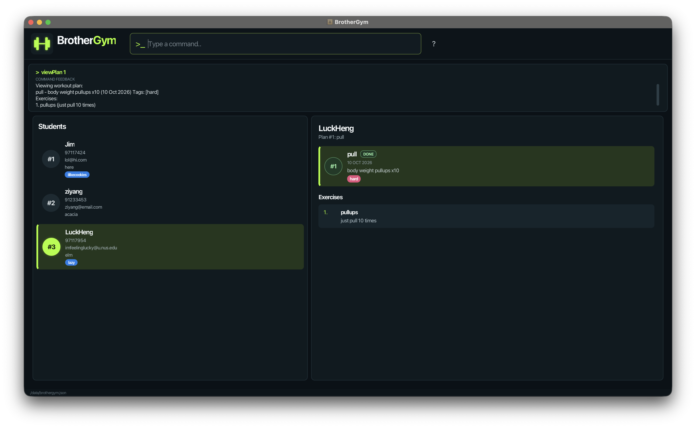

# BrotherGym User Guide

BrotherGym is a **desktop application for gym trainers to manage the workout plans of their students, optimized for use through a Command Line Interface (CLI)** while retaining the benefits of a Graphical User Interface (GUI). 
If you type quickly, BrotherGym can help you manage students and workouts faster than traditional GUI applications.

<!-- * Table of Contents -->
<page-nav-print />

--------------------------------------------------------------------------------------------------------------------

## Quick start

1. Ensure that Java `25` or later is installed on your computer. 
   **Mac users:** Ensure you have the precise JDK version prescribed [here](https://se-education.org/guides/tutorials/javaInstallationMac.html).

1. Download the latest `.jar` file from [here](https://github.com/AY2627S1-CS2103T-T11-4/tp/releases).

1. Copy the file to the folder you want to use as the _home folder_ for your BrotherGym.

1. Open a terminal, `cd` to the folder containing the JAR file, and run `java -jar brothergym.jar`. 
   A GUI similar to the one below should appear in a few seconds. Note how the app contains some sample data. 
   

1. Type a command in the command box and press Enter to execute it. For example, type **`help`** and press Enter to open the help window. 
   Some example commands you can try:

   * `home` : Lists all contacts.

   * `addStudent John Doe --hp 98765432 --email johnd@example.com --addr John street, block 123, #01-01`: 
     Adds a student named `John Doe` to the BrotherGym student list.
   
   * `viewStudent 2` : View all workout plans of the 2nd student in the current list.

   * `addPlan Leg Day --plan Squats 100kg 5 reps x5; Leg curls 80kg 10 reps x3 --date 20102026`: 
     Adds a plan named `Leg Day` to the workout plan list for the current student.

   * `deleteStudent 3` : Deletes the 3rd student shown in the current BrotherGym student list.

   * `clear` : Deletes all contacts.

   * `exit` : Exits the app.

1. Refer to the [Features](#features) section below for details of each command.

--------------------------------------------------------------------------------------------------------------------

## Features

<box type="info" seamless>

**Notes about the command format:** 

* Words in `UPPER_CASE` are the parameters to be supplied by the user. 
  For example, in `addStudent NAME`, replace `NAME` with a value such as `John Doe`.

* Items in square brackets are optional. 
  For example, `--name NAME [--tag TAG]` can be used as `--name John Doe --tag friend` or as `--name John Doe`.

* Items followed by `...` can appear zero or more times. 
  For example, `[--tag TAG]... ` may be omitted, or written as `--tag friend` or `--tag friend --tag family`.

* Parameters can be in any order. 
  For example, if the command specifies `--name NAME --hp PHONE_NUMBER`, `--hp PHONE_NUMBER --name NAME` is also acceptable.

* Extraneous parameters for commands that take no parameters, such as `help`, `home`, `exit`, and `clear`, are ignored. 
  For example, `help 123` is interpreted as `help`.

* If you are using a PDF version of this document, be careful when copying and pasting commands that span multiple lines as space characters surrounding line-breaks may be omitted when copied over to the application.
</box>

### Viewing help: `help`

Shows a message explaining how to access the help page.

Format: `help`

### Student-related Commands

#### Adding a student: `addStudent`

Adds a student to the BrotherGym student list.

Format: `addStudent NAME --hp PHONE_NUMBER --email EMAIL --addr ADDRESS [--tag TAG]... `

* Displays the updated BrotherGym student list after the new student is added.
* Name can only contain alphanumeric characters
* Phone number should be at least 3 digits long
* Email has to follow the format of `<name>@<domain>`
* Address cannot be empty

<box type="tip" seamless>

**Tip:** A student can have any number of tags, including zero.
</box>

Examples:
* `addStudent John Doe --hp 98765432 --email johnd@example.com --addr John street, block 123, #01-01`
* `addStudent Betsy Crowe --tag friend --email betsycrowe@example.com --addr Newgate Prison --hp 1234567 --tag criminal`

#### Listing all students: `home`

Shows a list of all students in the BrotherGym student list.

Format: `home`

#### Editing a student: `editStudent`

Edits an existing student in the BrotherGym student list.

Format: `editStudent INDEX [--name NAME] [--hp PHONE] [--email EMAIL] [--addr ADDRESS] [--tag TAG]... `

* Edits the student at the specified `INDEX`. The index refers to the index number shown in the displayed student list. The index **must be a positive integer** 1, 2, 3, ...
* At least one of the optional fields must be provided.
* Existing values will be updated to the input values.
* When editing tags, all of the student's existing tags are removed; adding tags is not cumulative.
* To remove all of a student's tags, enter `--tag` without a tag after it.

Examples:
*  `editStudent 1 --hp 91234567 --email johndoe@example.com` Edits the phone number and email address of the 1st student to be `91234567` and `johndoe@example.com` respectively.
*  `editStudent 2 --name Betsy Crower --tag` Edits the name of the 2nd student to be `Betsy Crower` and clears all existing tags.

#### Locating students by name: `find`

Finds students whose names contain any of the given keywords.

Format: `find KEYWORD [MORE_KEYWORDS]...`

* The search is case-insensitive; for example, `hans` matches `Hans`.
* Keyword order does not matter; for example, `Hans Bo` matches `Bo Hans`.
* The search considers only names.
* Only full words match; for example, `Han` does not match `Hans`.
* Students matching at least one keyword are returned (an `OR` search); for example, `Hans Bo` returns `Hans Gruber` and `Bo Yang`.

Examples:
* `find John` returns `john` and `John Doe`
* `find alex david` returns `Alex Yeoh`, `David Li` 
  

#### Viewing all workout plans of a student: `viewStudent`

Displays all the workout plans saved for the specified student.

Format: `viewStudent INDEX`

* Displays the list of workout plans for the student at the specified `INDEX`,
  which can now be edited through [workout plan commands](#workout-plan-related-commands)
* The index refers to the index number shown in the displayed student list.
* The index **must be a positive integer** 1, 2, 3, ...

#### Deleting a student: `deleteStudent`

Deletes the specified student from the BrotherGym student list.

Format: `deleteStudent INDEX`

* Deletes the student at the specified `INDEX`.
* The index refers to the index number shown in the displayed student list.
* The index **must be a positive integer** 1, 2, 3, ...

Examples:
* `home` followed by `deleteStudent 2` deletes the 2nd student in the BrotherGym student list.
* `find Betsy` followed by `deleteStudent 1` deletes the 1st student in the results of the `find` command.

### Workout plan related commands
These commands can only be performed after a specific student has been selected via `viewStudent`

#### Add a workout plan to a student: `addPlan`

Add a new workout plan to the list of workout plans of the specified student

Format: `addPlan TITLE --plan DESCRIPTION --date DDMMYYYY [--tag TAG]...`

* Displays the updated list of workout plans of the specified student, after the new plan is added
* Title and description of the workout plan cannot be empty
* Date field must be provided in `DDMMYYYY` format

Examples:
* `addPlan Leg Day --plan Squats 100kg 10 reps x5; Leg curls 80kg 10 reps x3 --date 20102026`
* `addPlan Chest Day --plan Bench press 80kg 15 reps x3 --date 31102026`

#### Edit a workout plan of a student: `editPlan`

Edits an existing workout plan from the student's list of workout plans

Format: `editPlan INDEX [--name TITLE] [--plan DESCRIPTION] [--date DDMMYYYY] [--tag TAG]... `

* Edits the plan at the specified `INDEX`. The index refers to the index number shown in the displayed list of workouts. 
  The index **must be a positive integer** 1, 2, 3, ...
* At least one of the optional fields must be provided.
* Existing values will be updated to the input values.
* When editing tags, all of the workout plan's existing tags are removed; adding tags is not cumulative.
* To remove all of a workout plan's tags, enter `--tag` without a tag after it.

Examples:
* `editPlan 2 --plan Bicep Curls 15kg 10 reps x3 --date 06072027`: 
   Edits the description and date of the second workout plan of the student's list of workout plans 
   to `Bicep Curls 15kg 10 reps x3` and `06072027`
* `editPlan 3 --tag`: Clears all tags for the third workout plan of the student's list of workout plans

#### Changing statuses of commands: `markPlan` and `unmarkPlan`

By default, workout plans have a `PENDING` status, which will change to `OVERDUE` when the `workoutDate` has passed.

`markPlan` updates the status of a workout plan to `COMPLETED`.

Format: `markPlan INDEX`

* Marks the workout plan at the specified `INDEX` as `COMPLETED` 
* The index refers to the index number shown in the displayed list of workouts
* The index **must be a positive integer** 1, 2, 3, ...

`unmarkPlan` reverts the status of the workout plan to either `PENDING` or `OVERDUE`

Format: `unmarkPlan INDEX`

* Reverts the status of the workout plan at the specified `INDEX`
* The index refers to the index number shown in the displayed list of workouts
* The index **must be a positive integer** 1, 2, 3, ...

#### Viewing details of a workout plan: `viewPlan`

Displays the details of the workout plan of a student

Format: `viewPlan INDEX`

* Displays the description of the workout plan at the specified `INDEX`.
* The index refers to the index number shown in the displayed list of workouts.
* The index **must be a positive integer** 1, 2, 3, ...

#### Deleting a workout plan: `deletePlan`

Deletes the specified workout plan from the list of workouts of the selected student.

Format: `deletePlan INDEX`

* Deletes the workout plan at the specified `INDEX`.
* The index refers to the index number shown in the displayed list of workouts of the student.
* The index **must be a positive integer** 1, 2, 3, ...

### Clearing all entries: `clear`

Clears all entries from the BrotherGym student list.

Format: `clear`

### Exiting the program: `exit`

Exits the program.

Format: `exit`

## Saving the data

BrotherGym automatically saves data after every command. You do not need to save manually.

### Editing the data file

BrotherGym data is saved automatically as a JSON file `[JAR file location]/data/brothergym.json`. Advanced users are welcome to update data directly by editing that data file.

<box type="warning" seamless>

**Caution:**
If your changes make the data file invalid, BrotherGym starts with an empty student list at the next run. The invalid file remains on disk until you run a command (BrotherGym saves after every command). Still, we recommend backing up the file before editing it. 
Furthermore, certain edits can cause the BrotherGym to behave in unexpected ways (e.g., if a value entered is outside of the acceptable range). Therefore, edit the data file only if you are confident that you can update it correctly.

</box>

### Archiving data files `[coming in v2.0]`

_Details coming soon ..._

--------------------------------------------------------------------------------------------------------------------

## FAQ

**Q**: How do I transfer my data to another computer? 
**A**: Install the app on the other computer and overwrite the data file it creates with the data file from your previous BrotherGym home folder.

--------------------------------------------------------------------------------------------------------------------

## Known issues

1. **When using multiple screens**, if you move the application to a secondary screen, and later switch to using only the primary screen, the GUI will open off-screen. The remedy is to delete the `preferences.json` file created by the application before running the application again.
2. **If you minimize the Help Window** and then run the `help` command (or use the `Help` menu, or the keyboard shortcut `F1`) again, the original Help Window will remain minimized, and no new Help Window will appear. The remedy is to manually restore the minimized Help Window.

--------------------------------------------------------------------------------------------------------------------

## Command summary
General Commands

Action     | Format, Examples 
-----------|------------------
**Return to homepage (List all students)**   | `home`
**Help**   | `help`           
**Exit**   | `exit`           

Student-related commands

Action     | Format, Examples
-----------|----------------------------------------------------------------------------------------------------------------------------------------------------------------------
**Add Student**    | `addStudent NAME --hp PHONE_NUMBER --email EMAIL --addr ADDRESS [--tag TAG]... `   e.g., `addStudent James Ho --hp 22224444 --email jamesho@example.com --addr 123, Clementi Rd, 1234665 --tag friend --tag colleague`
**Edit Student**   | `editStudent INDEX [--name NAME] [--hp PHONE_NUMBER] [--email EMAIL] [--addr ADDRESS] [--tag TAG]... `  e.g.,`editStudent 2 --name James Lee --email jameslee@example.com`
**View Student** | `viewStudent INDEX`  e.g., `viewStudent 2`
**Find Student**   | `find KEYWORD [MORE_KEYWORDS]`  e.g., `find James Jake`
**Delete Student** | `deleteStudent INDEX`  e.g., `deleteStudent 3`
**Clear all Students**  | `clear`

Workout plan-related commands

Action     | Format, Examples
-----------|----------------------------------------------------------------------------------------------------------------------------------------------------------------------
**Add Workout Plan**    | `addPlan TITLE --plan DESCRIPTION --date DDMMYYYY [--tag TAG]... `   e.g., `addPlan Leg Day --plan Squats 100kg 5 reps x5; Leg curls 80kg 10 reps x3 --date 20102026`
**Edit Workout Plan**   | `editPlan INDEX [--name NAME] [--plan DESCRIPTION] [--date DDMMYYYY] [--tag TAG]... `  e.g.,`editPlan 2 --date 06072027`
**Mark Workout Plan** | `markPlan INDEX`   e.g. `markPlan 2`
**Unmark Workout Plan** | `unmarkPlan INDEX`   e.g. `unmarkPlan 2`
**View Workout Plan** | `viewPlan INDEX`  e.g., `viewPlan 2`
**Delete Workout Plan** | `deletePlan INDEX`  e.g., `deletePlan 3`

