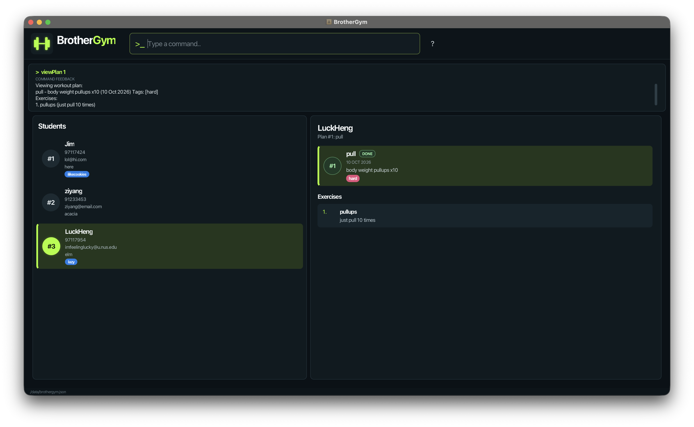
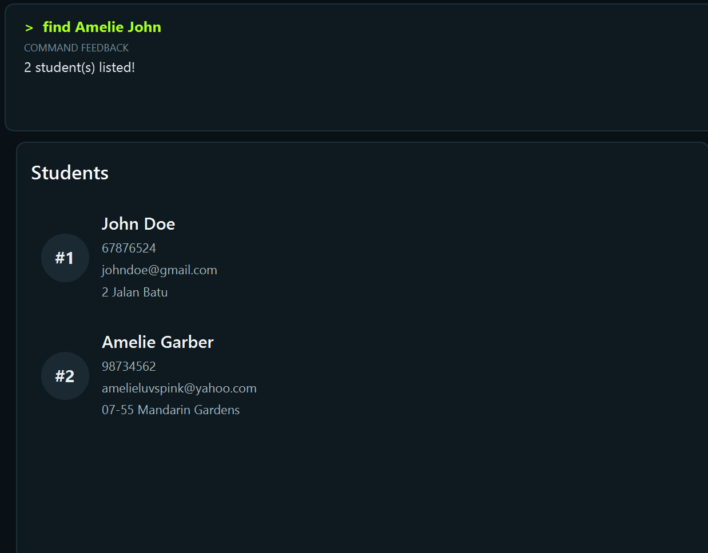
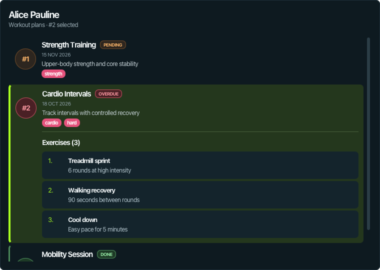

# BrotherGym User Guide

BrotherGym is a **desktop application for gym trainers to manage the workout plans of their students, optimized for use through a Command Line Interface (CLI)** while retaining the benefits of a Graphical User Interface (GUI).
If you type quickly, BrotherGym can help you manage students and workouts faster than traditional GUI applications.

<!-- * Table of Contents -->
<page-nav-print />

--------------------------------------------------------------------------------------------------------------------

## Quick start

1. Ensure that Java `25` or later is installed on your computer. 
   **Mac users:** Ensure you have the precise JDK version prescribed [here](https://se-education.org/guides/tutorials/javaInstallationMac.html).

1. Download the latest `.jar` file from [here](https://github.com/AY2627S1-CS2103T-T11-4/tp/releases).

1. Copy the file to the folder you want to use as the _home folder_ for your BrotherGym.

1. Open a terminal, `cd` to the folder containing the JAR file, and run `java -jar brothergym.jar`. 
   A GUI similar to the one below should appear in a few seconds. Note how the app contains some sample data. 
   

1. Type a command in the command box and press Enter to execute it. For example, type **`help`** and press Enter to open the help window. 
   Some example commands you can try:

   * `home` : Lists all students.

   * `addStudent John Doe --hp 98765432 --email johnd@example.com --addr John street, block 123, #01-01`:
     Adds a student named `John Doe` to the BrotherGym student list.

   * `viewStudent 2` : Selects the second student in the list to view all workout plans of that student.

   * `addPlan Leg Day --description focus on form --date 20102026`:
     Adds a plan named `Leg Day` to the workout plan list for the selected student.

   * `viewPlan 2`: Selects the second plan of the selected student, to view all the exercises contained in that workout plan

   * `addExercise Squats --description 30kg * 5 reps`: Adds an exercise called `Squats` in the selected workout plan.

   * `deleteStudent 3` : Deletes the 3rd student shown in the current BrotherGym student list.

   * `clear` : Deletes all students and their workout plans and exercises.

   * `exit` : Exits the app.

1. Refer to the [Features](#features) section below for details of each command.

--------------------------------------------------------------------------------------------------------------------

## Features

<box type="info" seamless>

**Notes about the command format:** 

* Words in `UPPER_CASE` are the parameters to be supplied by the user. 
  For example, in `addStudent NAME`, replace `NAME` with a value such as `John Doe`.

* Items in square brackets are optional. 
  For example, `--name NAME [--tag TAG]` can be used as `--name John Doe --tag friend` or as `--name John Doe`.

* Items followed by `...` can appear zero or more times. 
  For example, `[--tag TAG]... ` may be omitted, or written as `--tag friend` or `--tag friend --tag family`.

* Every `--tag` prefix must be followed by a non-empty alphanumeric tag. The valueless `--clearTags` flag is only
  available for edit commands and must not be followed by a value.

* Parameters can be in any order. 
  For example, if the command specifies `--name NAME --hp PHONE_NUMBER`, `--hp PHONE_NUMBER --name NAME` is also acceptable.

* Additional parameters or prefixes would cause the command to not be processed.

* Indexes such as `STUDENT_ID`, `PLAN_ID`, and `EXERCISE_ID` must be positive integers without leading zeros. For example, `1` is valid but `0001` is rejected.

* If you are using a PDF version of this document, be careful when copying and pasting commands that span multiple lines as space characters surrounding line-breaks may be omitted when copied over to the application.
</box>

### General Commands

#### Listing all students: `home`

Return to the homepage (i.e. removes all selections and filters).

Format: `home`

#### Viewing help: `help`

Opens the help page.

Format: `help`

#### Exiting the program: `exit`

Exits the program.

Format: `exit`

### Student-related commands

Students are referenced by `STUDENT_ID`, the positive index displayed beside a student in the current student list. 
When a command accepts `STUDENT_ID`, it must be a positive integer (e.g., `1`, `2`, or `3`).

#### Adding a student: `addStudent`

Adds a student to the BrotherGym student list.

Format: `addStudent NAME --hp PHONE_NUMBER --email EMAIL --addr ADDRESS [--tag TAG]... `

* Displays the updated BrotherGym student list after the new student is added.
* Name can only contain alphanumeric characters, and are case insenitive
* Phone number should be 7-15 digits long
* Email must be `<name>@<domain>`, at least 6 characters overall, and at most 64 characters on each side of `@`
* Address cannot be empty and cannot exceed 256 characters
* Tag should not be multiple words long 

<box type="warning" seamless>

The student list can only contain up to 999 students.

</box>

<box type="tip" seamless>

**Tip:** A student can have up to 30 distinct tags

</box>

Examples:
* `addStudent John Doe --hp 98765432 --email johnd@example.com --addr John street, block 123, #01-01`
* `addStudent Betsy Crowe --tag friend --email betsycrowe@example.com --addr Newgate Prison --hp 1234567 --tag criminal`

#### Editing a student: `editStudent`

Edits an existing student in the BrotherGym student list.

Format: `editStudent STUDENT_ID [--name NAME] [--hp PHONE] [--email EMAIL] [--addr ADDRESS] [--tag TAG]... [--clearTags]`

* Edits the student at the specified `STUDENT_ID`.
* At least one of the optional fields must be provided.
* Existing values will be updated to the input values.
* Existing tags will be replaced by the new tags supplied.
* To remove all of a student's tags, enter `--clearTags` without a value.
* If both `--tag TAG` and `--clearTags` are supplied, all tags are cleared.

Examples:
*  `editStudent 1 --hp 91234567 --email johndoe@example.com` Edits the phone number and email address of the 1st student to be `91234567` and `johndoe@example.com` respectively.
*  `editStudent 2 --name Betsy Crower --clearTags` Edits the name of the 2nd student to be `Betsy Crower` and clears all existing tags.
*  `editStudent 1 --tag temporary --clearTags` clears all tags, including `temporary`.

#### Viewing all workout plans of a student: `viewStudent`

Displays all the workout plans saved for the specified student.

Format: `viewStudent STUDENT_ID`

* Displays the list of workout plans for the student at the specified `STUDENT_ID`,
  which can now be edited through [workout plan commands](#workout-plan-related-commands)

#### Locating students by name: `find`

Finds students whose names contain any of the given keywords.

Format: `find KEYWORD [MORE_KEYWORDS]...`

* The search is case-insensitive; for example, `hans` matches `Hans`.
* Keyword order does not matter; for example, `Hans Bo` matches `Bo Hans`.
* Only full words match; for example, `Han` does not match `Hans`.
* Students matching at least one keyword are returned (an `OR` search); for example, `Hans Bo` returns `Hans Gruber` and `Bo Yang`.
* At least one keyword must contain only letters and digits, following the student-name format.
  Searches such as `find !!!` or `find Alice! Bob?` show an error and command usage.
  Mixed input such as `find Alice !!!` still searches for `Alice`.

Examples:
* `find Amelie John` returns `Amelie Garber` and `John Doe`

  

#### Deleting a student: `deleteStudent`

Deletes the specified student from the BrotherGym student list.

Format: `deleteStudent STUDENT_ID`

* Deletes the student at the specified `STUDENT_ID`.

Examples:
* `home` followed by `deleteStudent 2` deletes the 2nd student in the BrotherGym student list.
* `find Betsy` followed by `deleteStudent 1` deletes the 1st student in the results of the `find` command.

#### Clearing all students: `clear`

Clears all students from BrotherGym, along with their workout plans and exercises.

Format: `clear`

### Workout plan-related commands

<box type="important">

Select a student with `viewStudent STUDENT_ID` before using workout plan commands.
The workout plan commands will modify the workout plans of this student.

</box>

Workout plans are referenced by `PLAN_ID`, the positive index displayed beside a plan in the selected student’s workout-plan list.
When a command accepts `PLAN_ID`, it must be a positive integer (e.g., `1`, `2`, or `3`).

#### Add a workout plan to a student: `addPlan`

Add a new workout plan to the list of workout plans of the specified student

Format: `addPlan PLAN_NAME --description DESCRIPTION --date DDMMYYYY [--tag TAG]...`

* Displays the updated list of workout plans of the specified student, after the new plan is added
* Name and description of the workout plan cannot be empty.
* Description cannot exceed 500 characters.
* Date field must be provided in `DDMMYYYY` format

Examples:
* `addPlan Leg Day --description focus on form --date 20102026`
* `addPlan Chest Day --description Push for PR --date 31102026`

<box type="tip" seamless>

**Tip:** A workout plan can have up to 30 distinct tags

</box>

#### Edit a workout plan of a student: `editPlan`

Edits an existing workout plan from the student's list of workout plans

Format: `editPlan PLAN_ID [--name PLAN_NAME] [--description DESCRIPTION] [--date DDMMYYYY] [--tag TAG]... [--clearTags]`

* Edits the plan at the specified `PLAN_ID`.
* At least one of the optional fields must be provided.
* Existing values will be updated to the input values.
* Existing tags will be replaced by the new tags supplied.
* To remove all of a workout plan's tags, enter `--clearTags` without a value.
* If both `--tag TAG` and `--clearTags` are supplied, all tags are cleared.

Examples:
* `editPlan 2 --description Bicep Curls 15kg 10 reps x3 --date 06072027`:
   Edits the description and date of the second workout plan of the student's list of workout plans
   to `Full body conditioning` and `06072027`
* `editPlan 3 --clearTags`: Clears all tags for the third workout plan of the student's list of workout plans

#### Changing statuses of commands: `markPlan` and `unmarkPlan`

Workout plans have a completion status which is either `PENDING`, `OVERDUE` or `DONE`

* The status of a workout plan only changes from `PENDING` to `OVERDUE` only after the workout plan date has elapsed.
  (i.e. the status of a workout plan on `03112026` will only become `OVERDUE` on `04112026`)
* After marking the workout plan, the status of the workout plan changes to `DONE`, regardless of date.

`markPlan` updates the status of a workout plan to `DONE`.

Format: `markPlan PLAN_ID`

* Marks the workout plan at the specified `PLAN_ID` as `DONE` 
* Shows an error if the workout plan is already marked as completed

`unmarkPlan` reverts the status of the workout plan to either `PENDING` or `OVERDUE`, depending on the date.

Format: `unmarkPlan PLAN_ID`

* Reverts the status of the workout plan at the specified `PLAN_ID`
* Shows an error if the workout plan is already unmarked (`PENDING` or `OVERDUE`)

#### Viewing details of a workout plan: `viewPlan`

Expands the selected workout plan and its exercises within the current student's workout list.

Format: `viewPlan PLAN_ID`

* Displays the list of workout plans for the student at the specified `STUDENT_ID`,
  which can now be edited through [exercise commands](#exercise-related-commands)
* Keeps all of the student's workout plans visible in their original order and expands the selected plan in place.

Example: `viewStudent 1` followed by `viewPlan 2` expands the second plan in place while retaining the surrounding workout cards.

#### Deleting a workout plan: `deletePlan`

Deletes the specified workout plan from the list of workouts of the selected student.

Format: `deletePlan PLAN_ID`

* Deletes the workout plan at the specified `PLAN_ID`.

### Exercise-related commands

<box type="important">

Select a student with `viewStudent STUDENT_ID`, then select one of their workout plans with `viewPlan PLAN_ID` before using an exercise command.
The exercise commands will modify the exercises of this workout plan.

</box>

Exercises are referenced by `EXERCISE_ID`, the positive index displayed beside an exercise in the selected workout plan. 
When a command accepts `EXERCISE_ID`, it must be a positive integer (e.g., `1`, `2`, or `3`).

#### Add an exercise to a workout plan: `addExercise`

Add a new exercise to the specified workout plan.

Format: `addExercise EXERCISE_NAME --description DESCRIPTION`

* Displays the updated list of exercises of the specified workout plan,
  together with the other workout plans of the specified student.
* Name and description of the exercise cannot be empty.
* Description cannot exceed 500 characters.

Example: `addExercise Squats --description 30kg * 5 reps`

<box type="warning" seamless>

Each workout plan can only contain up to 100 exercises.

</box>

#### Editing an exercise: `editExercise`

Edits an existing exercise in the selected workout plan.

Format: `editExercise EXERCISE_ID [--name EXERCISE_NAME] [--description DESCRIPTION]`

* Edits the exercise at the specified `EXERCISE_ID`.
* At least one of the optional fields must be provided.
* Existing values will be updated to the input values.

Example: `editExercise 2 --name Goblet Squat --description 3 sets of 10 reps`

#### Deleting an exercise: `deleteExercise`

Deletes the specified exercise from the workout plan.

Format: `deleteExercise EXERCISE_ID`

* Delete the exercise at the specified `EXERCISE_ID`.

Example: `deleteExercise 2` removes the second exercise from the selected plan.

## Saving the data

BrotherGym automatically saves data after every command. You do not need to save manually.

### Editing the data file

BrotherGym data is saved automatically as `data/brothergym.json`, relative to the directory from which the app is run (the current working directory). Advanced users are welcome to update data directly by editing that data file.

<box type="warning" seamless>

**Caution:**
If your changes make the data file invalid, BrotherGym starts with an empty student list at the next run. The invalid file remains on disk until you run a command (BrotherGym saves after every command). Still, we recommend backing up the file before editing it. 
Furthermore, certain edits can cause the BrotherGym to behave in unexpected ways (e.g., if a value entered is outside of the acceptable range). Therefore, edit the data file only if you are confident that you can update it correctly.

</box>

## FAQ

**Q**: How do I transfer my data to another computer? 
**A**: Install the app on the other computer and overwrite the data file it creates with the data file from your previous BrotherGym home folder.

--------------------------------------------------------------------------------------------------------------------

## Known issues

1. **When using multiple screens**, if you move the application to a secondary screen, and later switch to using only the primary screen, the GUI will open off-screen. The remedy is to delete the `preferences.json` file created by the application before running the application again.
2. **If you minimize the Help Window** and then run the `help` command (or use the `Help` menu, or the keyboard shortcut `F1`) again, the original Help Window will remain minimized, and no new Help Window will appear. The remedy is to manually restore the minimized Help Window.
3. **If the application is used past midnight** , the workout plan statuses does not automatically refresh. The update is only invoked on plan-related and exercise-related commands. The remedy is to run viewStudent STUDENT_ID to refresh the workout plan statuses.

--------------------------------------------------------------------------------------------------------------------

## Command summary
General Commands

Action     | Format, Examples
-----------|------------------
**Return to homepage (List all students)**   | `home`
**Help**   | `help`
**Exit**   | `exit`

Student-related commands

Action     | Format, Examples
-----------|----------------------------------------------------------------------------------------------------------------------------------------------------------------------
**Add Student**    | `addStudent NAME --hp PHONE_NUMBER --email EMAIL --addr ADDRESS [--tag TAG]... `   e.g., `addStudent James Ho --hp 22224444 --email jamesho@example.com --addr 123, Clementi Rd, 1234665 --tag friend --tag colleague`
**Edit Student**   | `editStudent STUDENT_ID [--name NAME] [--hp PHONE_NUMBER] [--email EMAIL] [--addr ADDRESS] [--tag TAG]... [--clearTags]`  e.g.,`editStudent 2 --name James Lee --email jameslee@example.com`
**View Student** | `viewStudent STUDENT_ID`  e.g., `viewStudent 2`
**Find Student**   | `find KEYWORD [MORE_KEYWORDS]...`  e.g., `find James Jake`
**Delete Student** | `deleteStudent STUDENT_ID`  e.g., `deleteStudent 3`
**Clear all Students**  | `clear`

Workout plan-related commands

Action     | Format, Examples
-----------|----------------------------------------------------------------------------------------------------------------------------------------------------------------------
**Add Workout Plan**    | `addPlan PLAN_NAME --description DESCRIPTION --date DDMMYYYY [--tag TAG]... `   e.g., `addPlan Leg Day --description focus on form --date 20102026`
**Edit Workout Plan**   | `editPlan PLAN_ID [--name PLAN_NAME] [--description DESCRIPTION] [--date DDMMYYYY] [--tag TAG]... [--clearTags]`  e.g.,`editPlan 2 --date 06072027`
**Mark Workout Plan** | `markPlan PLAN_ID`   e.g. `markPlan 2`
**Unmark Workout Plan** | `unmarkPlan PLAN_ID`   e.g. `unmarkPlan 2`
**View Workout Plan** | `viewPlan PLAN_ID`  e.g., `viewPlan 2`
**Delete Workout Plan** | `deletePlan PLAN_ID`  e.g., `deletePlan 3`

Exercise-related commands

Action     | Format, Examples
-----------|----------------------------------------------------------------------------------------------------------------------------------------------------------------------
**Add Exercise** | `addExercise EXERCISE_NAME --description DESCRIPTION`  e.g., `addExercise Squats --description 30kg * 3 sets * 5 reps`
**Edit Exercise** | `editExercise EXERCISE_ID [--name EXERCISE_NAME] [--description DESCRIPTION]`  e.g., `editExercise 1 --description 30kg * 3 sets * 10 reps`
**Delete Exercise** | `deleteExercise EXERCISE_ID`  e.g., `deleteExercise 1`

